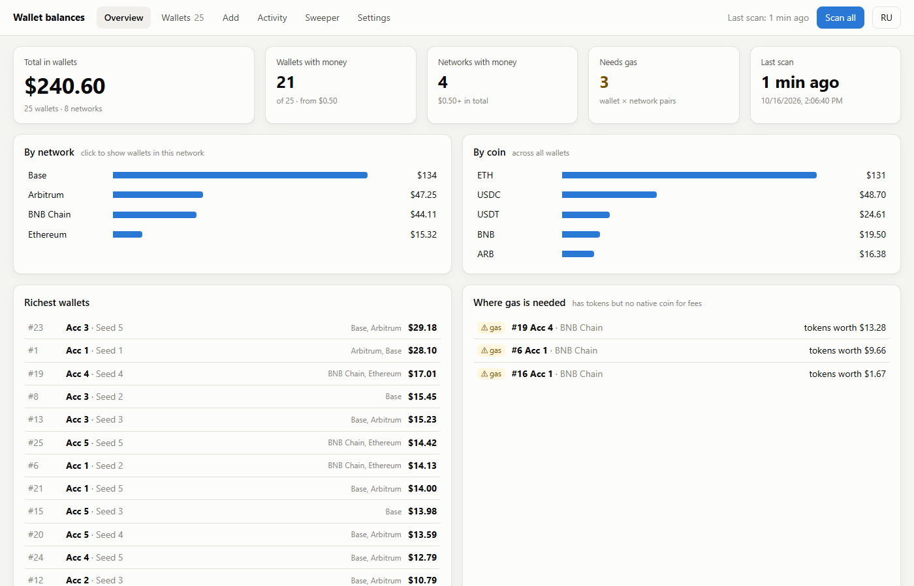
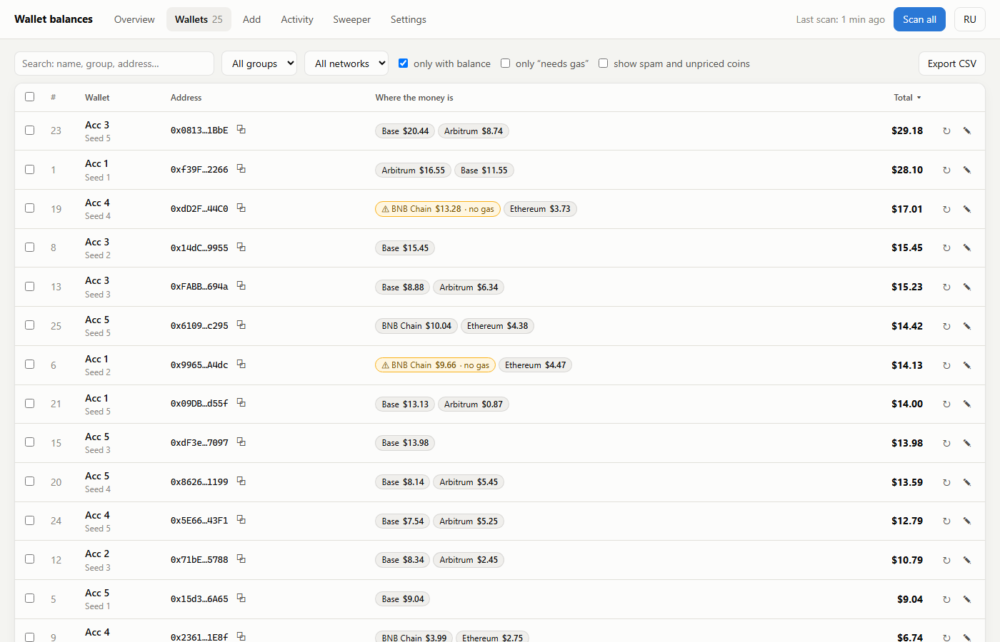
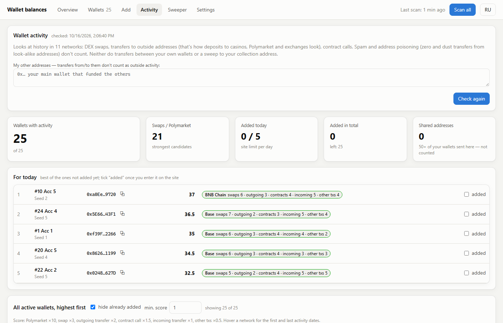

# Wallet Checker — balances of hundreds of EVM wallets in one panel

**[Русская версия →](README.ru.md)**

A local web panel for people with many EVM wallets (old airdrop farms, test wallets, forgotten seeds).
Paste addresses or seed phrases and see, across ~27 Ethereum L1/L2 networks:

- how much money is left and where (by wallet, network and token);
- which wallets have tokens but **no gas** to move them;
- which wallets were actually **used** (swaps, deposits, contract calls), ranked;
- and optionally **sweep** all leftovers to one address, with a dry-run plan first.

The author used it to find and collect **$76 spread over 940 forgotten wallets** — tiny amounts nobody would click through by hand.



> The interface is in **English and Russian** — switch with the EN/RU button in the header (or open `http://127.0.0.1:4777/?lang=en`).
> Screenshots show demo data (public Hardhat test wallets), not real users.

## Why it's safe to paste seed phrases here

- **Everything runs on your own computer.** The server listens on `127.0.0.1` only; there is no hosted version.
- **Seed phrases and private keys never leave the browser tab.** Addresses are derived right in the page; only
  addresses go to the local server and to disk (`data/`). For sweeping, transactions are signed in the page and
  keys are forgotten after sending, after 20 minutes, on a button or when the tab closes.
- Strict CSP: the page can only talk to the local server and the listed RPC hosts.
- The code is open — read it before you trust it. Start with `public/seeds.js` (derivation) and `public/sweep.js` (signing).

## Quick start

1. Install **Node.js 20+** from [nodejs.org](https://nodejs.org) (LTS).
2. Download the project:
   ```bash
   git clone https://github.com/hania666/crypto-wallet-checker.git
   cd crypto-wallet-checker
   npm install
   ```
3. Start it: `npm start` (on Windows you can double-click `start.bat`) and open **http://127.0.0.1:4777**.
4. Get a free **Alchemy API key** (balances and history come from Alchemy):
   1. Sign up at [dashboard.alchemy.com](https://dashboard.alchemy.com) — the free plan is enough.
   2. *Apps → Create new app*, any name. Enable the networks you need (or all EVM ones).
   3. Copy the **API Key** and paste it in the panel: **Settings → Alchemy API key → Save**.
      The panel checks which networks the key can read and switches off the rest.
5. **Add** → paste addresses (one per line, optional label) or seed phrases / private keys
   (one per line; choose how many accounts per seed and the derivation path: MetaMask/Rabby, Ledger Live, Legacy).
6. Press **Scan all**. 1,000 wallets take about 3 minutes.

Want to look around first without a key? `npm run demo` opens the panel with demo data on http://127.0.0.1:4779/?lang=en.

## Tabs

| Tab | What it does |
|---|---|
| **Overview** | Total value, value by network and by token, richest wallets, "needs gas" list, scan errors. |
| **Wallets** | Table with filters (group, network, non-empty, needs gas), per-network token details, explorer + DeBank links, CSV export, rescan errors, bulk delete. |
| **Add** | Addresses, seed phrases, private keys, `.txt` upload. Duplicates are skipped automatically, including a seed imported earlier — recognised by its addresses, the phrase itself is never stored. |
| **Activity** | Ranks wallets by real on-chain use in 11 networks: DEX swaps, transfers to outside addresses, contract calls, Polymarket. Ignores address-poisoning spam and transfers between your own wallets. A "5 for today" list with done-marks helps when a site lets you add only a few wallets per day. |
| **Sweeper** | Collects leftovers to one address: live dry-run plan with gas per transaction, "gas bus" (a wallet with spare native coin funds gas for token-only wallets when it pays off), reconciliation with the panel total, confirmation dialog, per-tx status and CSV log. Technical details (in Russian): [docs/SWEEPER.ru.md](docs/SWEEPER.ru.md). |
| **Settings** | API key, networks, dust threshold, hidden tokens, "start from scratch". |




## Networks

Ethereum, Arbitrum, Optimism, Base, zkSync Era, Linea, Scroll, Polygon, BNB Chain, Avalanche, Blast, Zora, Abstract,
Unichain, World Chain, Soneium, Ink, Berachain, ApeChain, Shape, Lens, Celo, Gnosis, Monad, HyperEVM, Ronin, Story.
(Alchemy's Portfolio API doesn't serve Arbitrum Nova, Polygon zkEVM, Mantle, Sonic, opBNB, Fraxtal, Metis, Mode, Plasma.)

## Where data lives

All in `data/` next to the code (git-ignored):

- `config.json` — your Alchemy key, networks, settings;
- `wallets.json` — addresses, labels, groups;
- `scan.json`, `activity.json` — last scan results.

“Start from scratch” in Settings clears wallets and results; delete the folder to remove everything.

## Good to know

- **Sweeping many wallets into one address links them on-chain forever** — airdrop anti-sybil filters will see them as one person.
- **Address poisoning is real:** scammers send zero-value transfers from look-alike addresses (same first and last characters).
  Never copy a destination address from transaction history — take it from your wallet app and compare all characters.
- Prices come from Alchemy; tokens without a price or that look like spam are hidden from totals (you can show them).

## Testing without real money

`testchain/` has a local Hardhat setup (EIP-1559, legacy and OP-stack chains) with public test mnemonics to run the
sweeper end to end. See (in Russian) [docs/SWEEPER.ru.md](docs/SWEEPER.ru.md#тестирование-на-локальных-сетях-без-реальных-денег).

## License

[MIT](LICENSE). Use at your own risk: always check the plan and the destination address before sending.
