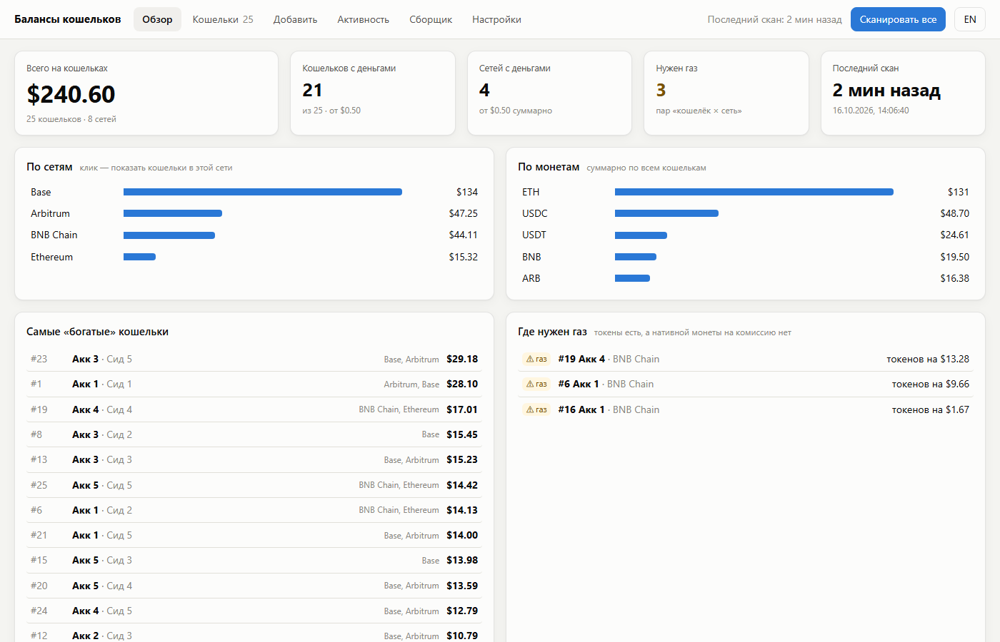
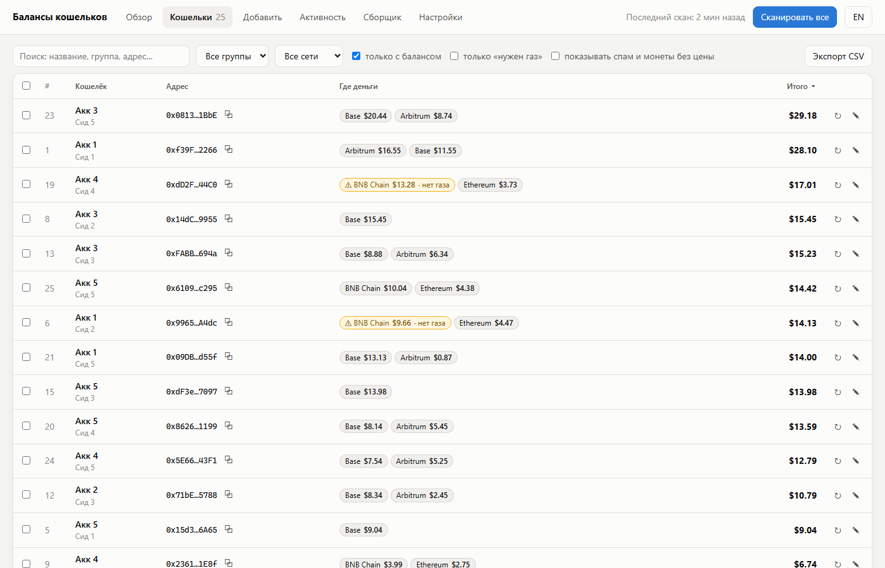
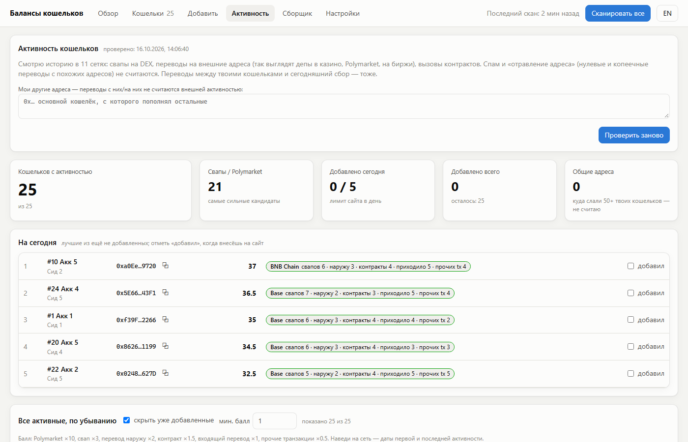

# Wallet Checker — балансы сотен EVM-кошельков в одной панели

**[English version →](README.md)**

Локальная веб-панель для тех, у кого много EVM-кошельков: старые фермы под аирдропы, тестовые кошельки,
забытые сид-фразы. Вставляешь адреса или сиды и видишь по ~27 сетям Ethereum (L1 и L2):

- сколько денег осталось и где: по кошелькам, сетям и монетам;
- на каких кошельках есть токены, но **нет газа**, чтобы их вывести;
- какие кошельки реально **использовались** (свапы, депозиты, контракты), с рейтингом;
- и при желании **собрать** все остатки на один адрес, сначала посмотрев план без отправки.

Автор нашёл и собрал этим **$76, размазанные по 940 забытым кошелькам**: суммы, которые руками никто бы не стал прокликивать.



> Интерфейс на **русском и английском**: переключается кнопкой RU/EN в шапке (или адресом `http://127.0.0.1:4777/?lang=ru`).
> На скриншотах демо-данные (публичные тестовые кошельки Hardhat), а не чьи-то реальные кошельки.

## Почему сюда можно вставлять сид-фразы

- **Всё работает у тебя на компьютере.** Сервер слушает только `127.0.0.1`, никакой онлайн-версии нет.
- **Сид-фразы и приватные ключи не покидают вкладку браузера.** Адреса из них получаются прямо на странице,
  а на локальный сервер и на диск (`data/`) уходят только адреса. При сборе транзакции подписываются на странице,
  ключи забываются после отправки, через 20 минут, по кнопке или при закрытии вкладки.
- Строгий CSP: странице разрешено ходить только на локальный сервер и перечисленные RPC.
- **Что всё-таки уходит с компьютера — адреса.** Чтобы прочитать балансы и историю, панель отправляет твои *адреса*
  (не сиды и не ключи) в Alchemy и публичные RPC, по несколько штук в запросе и с твоего IP. Провайдер может увидеть,
  что эти адреса проверяют вместе. Если это важно, включай VPN.
- Код открыт: прочитай, прежде чем доверять. Начни с `public/seeds.js` (получение адресов) и `public/sweep.js` (подпись).

## Быстрый старт

### Самый простой способ (Windows, одна команда)

1. Установи **Node.js** с [nodejs.org](https://nodejs.org): кнопка **LTS**, дальше «Далее → Далее → Установить».
   На шаге «Tools for Native Modules» **галочку не ставь**: проекту эти инструменты не нужны, а с галочкой
   после установки открывается синее окно, которое качает Visual Studio и часто падает с ошибками.
2. Нажми **Win + R**, напиши `cmd`, нажми Enter. Вставь в чёрное окно **одну строку** и нажми Enter:
   ```bat
   powershell -NoProfile -ExecutionPolicy Bypass -Command "iwr 'https://github.com/hania666/crypto-wallet-checker/archive/refs/heads/main.zip' -OutFile $env:USERPROFILE\wc.zip; Expand-Archive $env:USERPROFILE\wc.zip $env:USERPROFILE -Force; Set-Location $env:USERPROFILE\crypto-wallet-checker-main; cmd /c start.bat"
   ```
   Она сама скачает проект в твою папку пользователя (`C:\Users\<имя>\crypto-wallet-checker-main`),
   установит всё нужное и откроет панель на **http://127.0.0.1:4777**. Чёрное окно не закрывай, пока пользуешься панелью.
3. **В следующий раз:** открой `C:\Users\<имя>\crypto-wallet-checker-main` и дважды кликни **`start.bat`**.

Git и права администратора не нужны. Если Windows покажет «Система Windows защитила ваш компьютер» на `start.bat`,
нажми **Подробнее → Выполнить в любом случае**.

### Вручную (любая ОС)

1. Установи **Node.js 20+** с [nodejs.org](https://nodejs.org).
2. Скачай код: `git clone https://github.com/hania666/crypto-wallet-checker.git`
   или на этой странице **Code → Download ZIP** и распакуй.
3. В папке проекта: `npm install`, потом `npm start`, и открой **http://127.0.0.1:4777**.
   Команды запускай именно в папке проекта, а не в `C:\Windows\System32`, где открывается терминал администратора.

### Первый запуск

1. Возьми бесплатный **API-ключ Alchemy** (балансы и история приходят от Alchemy):
   1. Зарегистрируйся на [dashboard.alchemy.com](https://dashboard.alchemy.com), бесплатного тарифа хватает.
   2. *Apps → Create new app*, имя любое. Включи нужные сети (или все EVM).
   3. Скопируй **API Key** и вставь в панели: **Настройки → Alchemy API key → Сохранить**.
      Панель сама проверит, какие сети видит ключ, и выключит остальные.
2. **Добавить** → вставь адреса (по одному на строку, можно с названием) или сид-фразы и приватные ключи
   (по одной на строку; выбери, сколько аккаунтов брать с каждой сиды и путь: MetaMask/Rabby, Ledger Live, Legacy).
3. Нажми **«Сканировать все»**. 1000 кошельков проверяются примерно за 3 минуты.

Хочешь сначала посмотреть без ключа? `npm run demo:ru` откроет панель с демо-данными на http://127.0.0.1:4779/?lang=ru.

## Вкладки

| Вкладка | Что делает |
|---|---|
| **Обзор** | Общая сумма, разбивка по сетям и монетам, самые «богатые» кошельки, где нужен газ, ошибки скана. |
| **Кошельки** | Таблица с фильтрами (группа, сеть, только с балансом, нужен газ), монеты по сетям, ссылки на эксплорер и DeBank, экспорт CSV, пересканирование ошибок, массовое удаление. |
| **Добавить** | Адреса, сид-фразы, приватные ключи, загрузка из `.txt`. Дубли отсекаются сами, в том числе сида, загруженная раньше: она узнаётся по адресам, сама фраза нигде не хранится. |
| **Активность** | Рейтинг кошельков по реальному использованию в 11 сетях: свапы на DEX, переводы на внешние адреса, вызовы контрактов, Polymarket. Спам «отравления адресов» и переводы между своими кошельками не считаются. Блок «На сегодня» с отметками «добавил» удобен, когда сайт позволяет добавлять только несколько кошельков в день. |
| **Сборщик** | Сбор остатков на один адрес: живой план без отправки с газом по каждой транзакции, «газовый автобус» (кошелёк с запасом нативной монеты довозит газ тем, у кого только токены, если это выгодно), сверка с суммой в панели, окно подтверждения, статус каждой транзакции и журнал CSV. Подробности: [docs/SWEEPER.ru.md](docs/SWEEPER.ru.md). |
| **Настройки** | Ключ, сети, порог мелочи, скрытые монеты, «начать с нуля». |




## Сети

Ethereum, Arbitrum, Optimism, Base, zkSync Era, Linea, Scroll, Polygon, BNB Chain, Avalanche, Blast, Zora, Abstract,
Unichain, World Chain, Soneium, Ink, Berachain, ApeChain, Shape, Lens, Celo, Gnosis, Monad, HyperEVM, Ronin, Story.
(Arbitrum Nova, Polygon zkEVM, Mantle, Sonic, opBNB, Fraxtal, Metis, Mode и Plasma Portfolio API от Alchemy не поддерживает.)

## Где лежат данные

Всё в папке `data/` рядом с кодом (в git не попадает):

- `config.json` — твой ключ Alchemy, сети, настройки;
- `wallets.json` — адреса, названия, группы;
- `scan.json`, `activity.json` — результаты последних проверок.

«Начать с нуля» в настройках очищает кошельки и результаты. Чтобы удалить вообще всё, удали папку.

## Что важно знать

- **Сбор со многих кошельков на один адрес навсегда связывает их в блокчейне.** Антисибил-фильтры аирдропов увидят их как одного человека.
- **Отравление адресов — реальная угроза.** Мошенники присылают нулевые переводы с похожих адресов (совпадают первые и последние символы).
  Никогда не копируй адрес получателя из истории транзакций: бери его из приложения кошелька и сверяй целиком.
- Цены берутся у Alchemy. Монеты без цены и похожие на спам в итоги не входят (их можно показать).

## Проверка без реальных денег

В `testchain/` лежит локальный стенд Hardhat (сети EIP-1559, legacy и OP-stack) с публичными тестовыми фразами:
на нём можно прогнать сборщик от начала до конца. Как это сделать: [docs/SWEEPER.ru.md](docs/SWEEPER.ru.md#тестирование-на-локальных-сетях-без-реальных-денег).

## Лицензия

[MIT](LICENSE). Используешь на свой риск: перед отправкой всегда проверяй план и адрес получателя.
